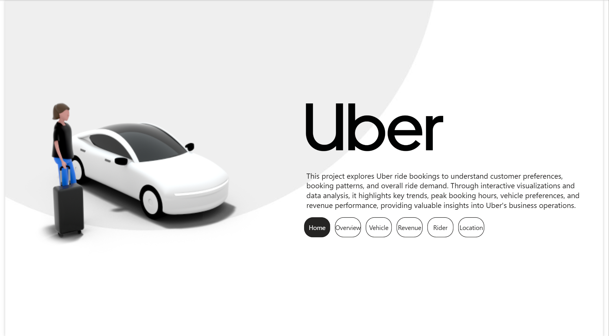
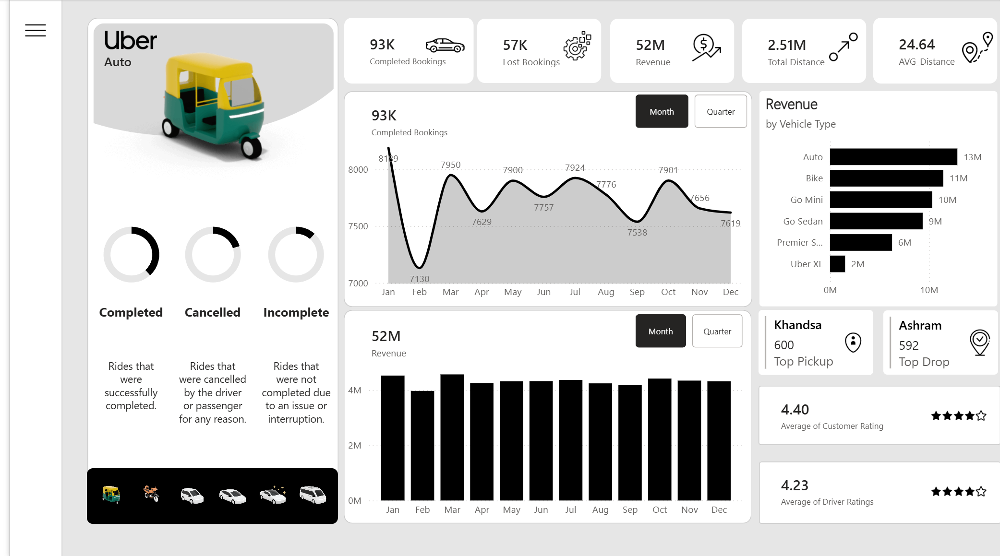
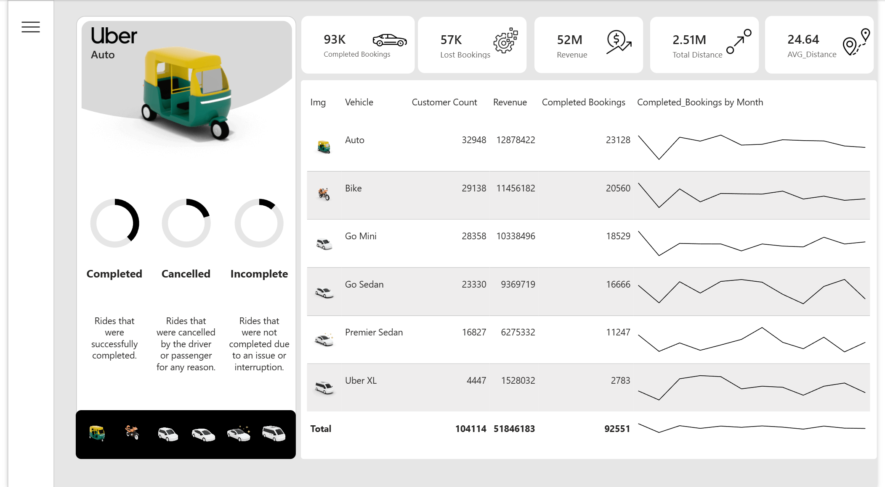
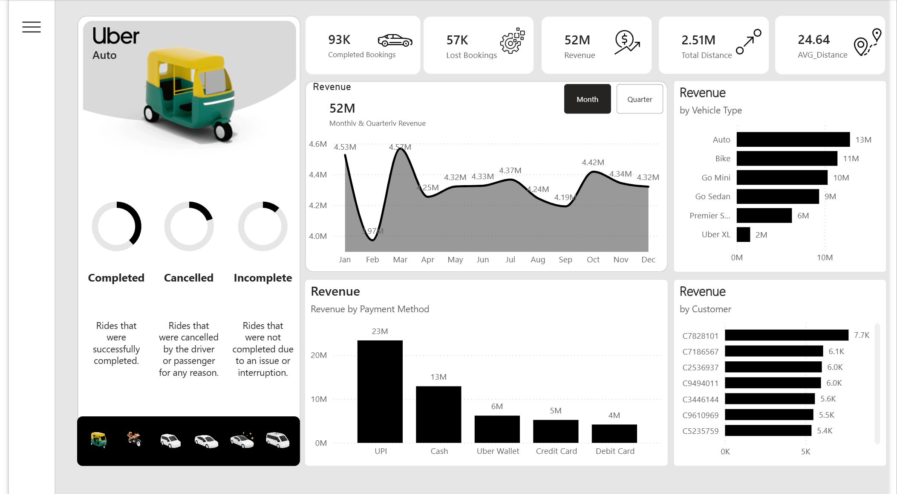
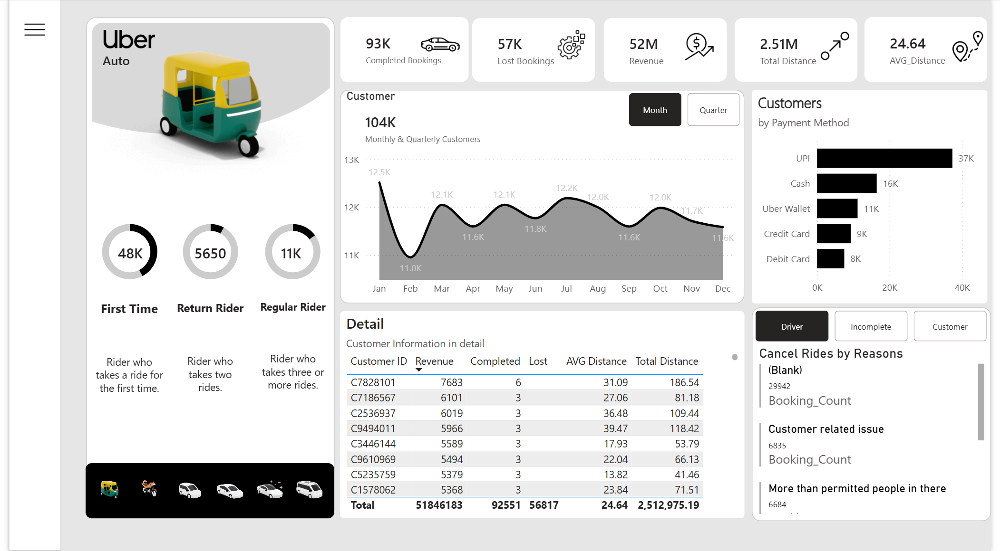
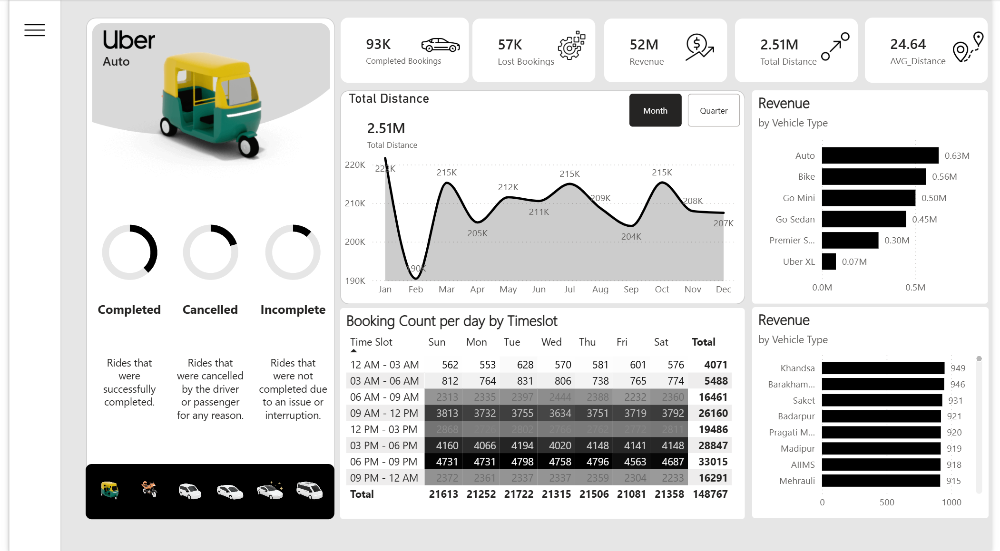

# Uber Ride Bookings | Power BI Analytics Dashboard

An interactive Power BI report that turns Uber ride-booking data into an operational view of demand, revenue, riders, vehicles, locations, and booking outcomes. The report is deliberately structured to answer a decision-maker's first questions quickly—*how large is the business, when does demand happen, what drives revenue, and where is service being lost?*—then lets them drill into the underlying segment.

> **Report file:** [`Uber_Project.pbix`](Uber_Project.pbix)  
> **Built with:** Microsoft Power BI Desktop



## Business objective

Ride-hailing performance is not a single number. A healthy revenue total can still conceal lost bookings, an unfavourable payment mix, weak service levels in a vehicle segment, or a demand peak that is not being matched with supply. This dashboard brings those signals into one navigable reporting experience so that operations and commercial teams can move from a headline metric to an actionable explanation.

The analysis is organized around these questions:

- How many bookings were completed versus lost, and what is the scale of revenue and distance travelled?
- How do bookings, distance, customers, and revenue change by month or quarter?
- Which vehicle types, payment methods, riders, and locations contribute most?
- When is demand strongest across the week and time of day?
- What cancellation reasons deserve operational attention?

## Dashboard design

The report contains six pages, verified from the PBIX report definition:

| Page | Decision focus | Why this view exists |
| --- | --- | --- |
| **Home** | Report purpose and navigation | Gives the user a clear entry point before they encounter detailed visuals. |
| **Overview** | Demand, fulfilment, distance, and location patterns | Establishes the operating picture and exposes when/where demand occurs. |
| **Vehicle** | Vehicle-level customers, revenue, completed bookings, and trends | Makes fleet mix comparable in one compact table with sparklines. |
| **Revenue** | Revenue trend and revenue composition | Separates overall performance from the channels and vehicle types creating it. |
| **Rider** | Rider lifecycle, payment preference, rider-level detail, and cancellation reasons | Connects customer behavior to value and service failure. |
| **Location** | Pick-up/drop-off performance and service ratings | Anchors demand and service quality to places. |

The layout uses a consistent left rail for navigation and vehicle selection, a top KPI strip for orientation, and a focused content area per page. This avoids repeating every chart everywhere: each page contributes a distinct analytical lens while the core KPIs preserve context.

## KPI definitions

The following labels and displayed values were verified from the supplied report screenshots. The exact DAX expressions could not be reliably recovered from the PBIX model binary, so the definitions below describe the reporting intent rather than claiming the original code.

| KPI | Displayed value | Reporting meaning |
| --- | ---: | --- |
| Completed Bookings | 93K | Rides classified as successfully completed. |
| Lost Bookings | 57K | Rides classified as not successfully completed, including cancellation/incompletion categories shown in the report. |
| Revenue | 52M | Reported ride revenue in the current filter context. |
| Total Distance | 2.51M | Sum of recorded trip distance in the current filter context. |
| AVG_Distance | 24.64 | Average trip distance in the current filter context. |
| Customer Count | 104K | Customer/rider count shown in the vehicle summary. |

**Important:** Units and currency are not labelled in the supplied screenshots. `M` and `K` are preserved exactly as rendered; do not infer a currency or distance unit without checking the model/source data.

## What the report shows

### Overview — convert demand into fulfilment decisions



The Overview page combines an area trend for total distance, a vehicle revenue ranking, a weekday × time-slot booking matrix, and a location ranking. The time-slot matrix is particularly useful for supply planning: the visible total is highest at **6 PM–9 PM (33,015)**, followed by **3 PM–6 PM (28,847)** and **9 AM–12 PM (26,160)**. Daily totals are closely grouped in the displayed view, so the operational signal is more about *time of day* than a single dominant weekday.

The page also makes the split between completed, cancelled, and incomplete outcomes visible as a recurring control point rather than treating revenue as the only success metric.

### Vehicle — compare the commercial and operational mix



The Vehicle page places vehicle types in a single comparison table with customer count, revenue, completed bookings, and monthly sparklines. In the displayed report state, **Auto** leads at **12,878,422** revenue and **23,128** completed bookings; **Bike** follows at **11,456,182** revenue and **20,560** completed bookings. This design enables a quick comparison of scale, value, and trend without forcing a user to switch between multiple charts.

### Revenue — distinguish total performance from its drivers



The Revenue page pairs monthly/quarterly switching with two composition views: vehicle type and payment method. In the shown monthly trend, revenue ranges from **3.97M in February** to **4.57M in March**. UPI is the largest displayed payment-method contributor at **23M**, ahead of Cash (**13M**), Uber Wallet (**6M**), Credit Card (**5M**), and Debit Card (**4M**). These views help distinguish a time-series movement from a change in the underlying revenue mix.

### Rider — turn customer detail into retention and service questions



The Rider page segments users as First Time, Return Rider, and Regular Rider, shows customer volume by payment method, ranks customers in a detailed table, and provides a cancellation-reason panel with Driver / Incomplete / Customer tabs. This is a useful progression from acquisition and repeat behavior to individual customer contribution and service-failure diagnosis. The supplied screenshot also shows a monthly customer trend that moves within a narrow band of roughly **11.0K–12.5K**.

### Location — connect demand with service experience



The Location page surfaces top pick-up and drop-off locations alongside monthly bookings/revenue and rating cards. In the displayed state, **Khandsa** is the top pick-up location (**600**) and **Ashram** is the top drop-off location (**592**). The rating cards show **4.40** average customer rating and **4.23** average driver rating, inviting a practical question: do high-demand locations also maintain a balanced rider/driver experience?

## Interactivity

- **Page navigation:** Home, Overview, Vehicle, Revenue, Rider, and Location buttons provide a guided analytical path.
- **Vehicle selection:** The left rail uses vehicle icons to focus the report on a vehicle type.
- **Time grain:** Month/Quarter buttons switch the time perspective on relevant trend visuals.
- **Cancellation diagnosis:** On the Rider page, Driver, Incomplete, and Customer buttons change the cancellation-reason view.
- **Cross-filtering:** As a Power BI report, selecting a data point can filter compatible visuals on the active page, subject to the interactions configured in the PBIX.

## Key observations from the supplied report state

These are observations of the provided screenshots—not universal business conclusions.

- Revenue and completed-booking leadership align for Auto, while Bike and Go Mini are also material contributors.
- March is the highest visible monthly revenue point; February is the lowest visible point.
- Evening demand is strongest in the booking-by-timeslot matrix, with 6 PM–9 PM clearly ahead of other displayed slots.
- Digital payment is prominent: UPI is the largest shown payment method for both revenue and customer count.
- The report preserves lost bookings and cancellation reasons alongside commercial metrics, making service recovery measurable rather than invisible.

## Workflow

1. Open the PBIX file in Power BI Desktop.
2. Review or update data-source credentials if Power BI requests them. The original source connection details are intentionally not documented here because they could not be verified from the supplied material.
3. Refresh the model if a valid source is configured.
4. Use the page navigation, vehicle controls, and Month/Quarter controls to explore the report.
5. Publish to a Power BI workspace only after validating data refresh, access, and privacy settings for your environment.

## Repository structure

```text
.
├── Uber_Project.pbix
├── README.md
└── assets/
    └── screenshots/
        ├── 01-Home.png
        ├── 02-Overview.png
        ├── 03-Vehicle.png
        ├── 04-Revenue.png
        ├── 05-Rider.png
        └── 06-Location.png
```

## Verification note

The PBIX container was inspected to confirm the six page names and report resources; the screenshots were used to verify the visual layout and displayed metrics. Because the underlying Power BI data model is stored in a binary format, this README does **not** claim exact table names, relationships, source systems, refresh schedule, data grain, currency, distance unit, or DAX implementations that were not verifiable from the supplied project artifacts.

## Disclaimer

This is a portfolio/analytics project based on the supplied report artifacts. It is not an official Uber report and should not be treated as a statement of Uber’s real-world performance.
